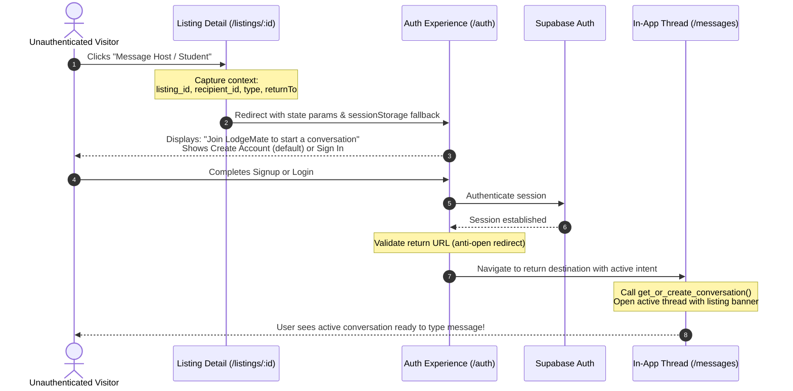
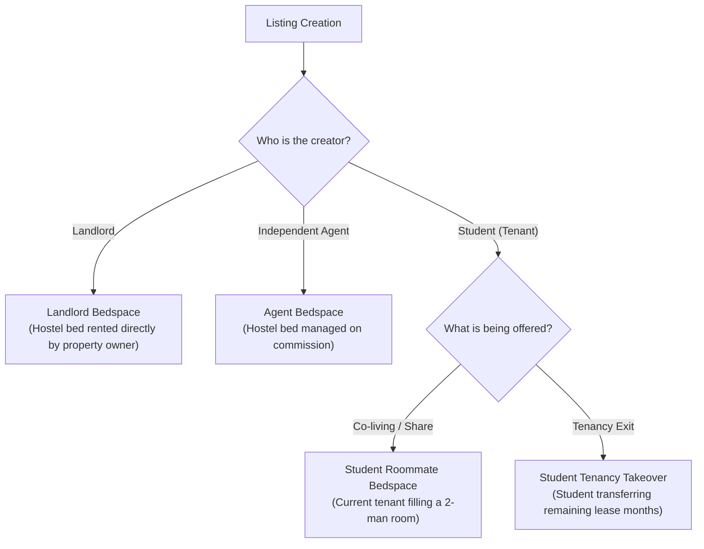
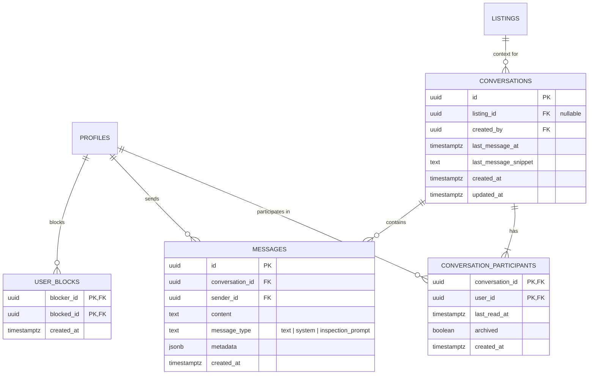
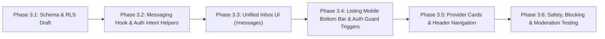
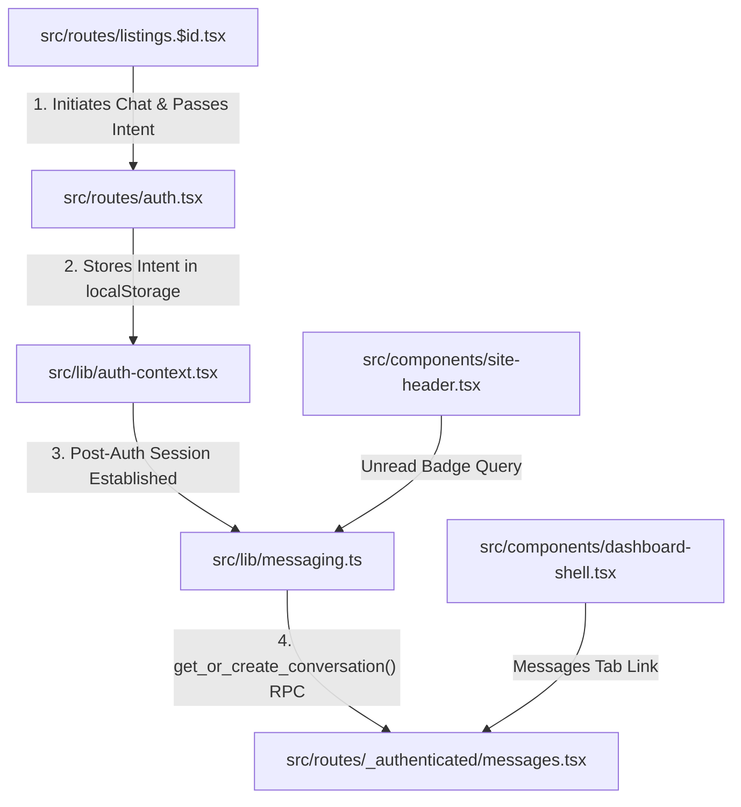

# LodgeMate Unified In-App Messaging: UX Research & System Architecture

**Document Version:** 1.1.0  
**Status:** Architecture Proposal & Specification (Pre-Implementation)  
**Target:** Unified In-App Messaging for Students, Landlords, and Independent Agents across MOUAU & ABSU

---

## 1. Executive Summary & Core Product Requirements

LodgeMate currently bridges accommodation discovery, inspection bookings, and verified landlord contacts (via Beta Passes). However, a critical communication gap exists between initial property discovery and physical inspection booking.

Students frequently have low-friction pre-inspection questions:
- *"Is the light supply backed by a dedicated generator or solar inverter?"*
- *"Are you looking for a quiet study roommate or any 200L–400L student?"*
- *"Can I come with my course mate to inspect tomorrow afternoon?"*

Currently, asking these questions requires either booking a formal inspection or revealing private phone numbers. In-app messaging bridges this gap.

### 1.1 Fundamental Authentication & Public Browsing Principles
1. **Public Browsing Must Remain 100% Open**:
   - Visitors without accounts must be completely free to browse accommodation, search listings, apply filters, view listing details, view public landlord/agent information, and explore student bedspace opportunities.
   - **LodgeMate will never force visitors to register simply to browse the site.**
2. **Messaging Strictly Requires an Authenticated LodgeMate Account**:
   - Sending or receiving messages and accessing the messaging inbox is exclusively reserved for registered, signed-in users.
   - Unauthenticated visitors must **never** be able to send or receive messages, view chat histories, or access the inbox.
   - This strict authentication boundary applies equally across all three relationships:
     - **Student ↔ Landlord**
     - **Student ↔ Independent Agent**
     - **Student ↔ Student** (Bedspaces & Roommate inquiries)
3. **Seamless Guest Onboarding & Context Return**:
   - When a guest clicks any Message action, they are directed to sign up or log in with clear context and explanatory copy.
   - Upon successful authentication, they are immediately returned to the listing and seamlessly transitioned into the intended conversation without losing context or creating duplicate threads.

---

## 2. Research: Established Accommodation Marketplace Conventions

To ensure LodgeMate feels instantly intuitive to Nigerian university students and local property hosts, we inspected market leaders:

### 2.1 Airbnb (Host-Guest Inquiry Pattern)
- **Action Hierarchy**: On listing pages, booking/reservation is the primary CTA (`Request to book` / `Reserve`). Inquiry is the secondary CTA (`Contact Host`).
- **Listing Context Header**: An inquiry thread always anchors the listing as a top banner containing the thumbnail, title, price, and cancellation/inspection terms. Neither party loses context of which property is being discussed.
- **Mobile Sticky Action Bar**: On viewport widths under 768px, Airbnb sticks a slim action bar to the bottom of the screen showing price on the left and the primary action on the right, keeping essential actions accessible without forcing the user to scroll past 20+ photos and amenity lists.
- **Authentication Gate**: Clicking "Contact host" as a guest triggers an auth modal; once signed in, the user is immediately dropped into the message composer for that specific host and property.

### 2.2 SpareRoom & Roomies (Peer-to-Peer & Flatmate Sharing Pattern)
- **Room Seeker vs. Room Provider Dichotomy**: Clear visual badges distinguish who is *offering* a room versus who is *seeking* a room.
- **Lifestyle & Compatibility Prompts**: Peer-to-peer messaging emphasizes compatibility: gender preferences, academic year, study habits, and cleanliness expectations.
- **In-App Safety Watermark**: In-app threads feature prominent anti-fraud reminders: *"Never transfer money or deposits before inspecting the room in person"*.

### 2.3 Nigerian University Housing Context (Umudike & Uturu Realities)
- **Fraud Vector Mitigation**: The highest vulnerability in student rentals is fake "commitment fees" or "inspection mobilization charges" requested before viewing.
- **Phone Number Protection**: Female students and new undergraduates often hesitate to share their personal WhatsApp or phone numbers with unvetted caretakers or unknown peers. In-app messaging provides a privacy shield until trust is established and an inspection is officially confirmed.

---

## 3. Chat Button Placement: Desktop & Mobile Evaluation

We evaluated 6 potential button placements across the platform:

| Location | Evaluation | Recommendation | Rationale |
| :--- | :--- | :--- | :--- |
| **A. Accommodation Listing Cards (Browse)** | ❌ **Rejected** | **DO NOT ADD** | Clutters card browsing. Cards exist for rapid scanning, price comparison, and campus filtering. Placing a Chat button on every card leads to accidental clicks and low-intent message spam without the student having read the lodge description, distance, or rules. |
| **B. Accommodation Detail Pages (`/listings/$id`)** | ✅ **Recommended (Primary)** | **PRIMARY CTA** | **Desktop**: Secondary button inside sticky sidebar action card beneath "Book Inspection", plus a "Message Host" link next to the host profile. <br>**Mobile**: Integrated into a fixed bottom action bar (see below). |
| **C. Public Landlord & Agent Cards (`/browse?scope=providers`)** | ✅ **Recommended (Secondary)** | **SECONDARY CTA** | Displayed alongside "View spaces" on provider cards. Initiates a general enquiry thread (with `listing_id = null`) when a student wants to ask an agent about upcoming vacancies. |
| **D. Student Bedspace/Takeover Listings** | ✅ **Recommended (Peer-to-Peer)** | **PRIMARY CTA** | For peer listings, "Message Student" is the **primary** action because finding a compatible roommate begins with conversation, not formal inspection booking. |
| **E. Public Student Profiles** | ❌ **Rejected** | **DO NOT ADD** | **Severe privacy risk**. Students must never have publicly browsable profiles for strangers to send unsolicited messages. Student identity is only accessible in the context of an active bedspace listing or a confirmed inspection. |
| **F. Dashboards (Student, Landlord, Agent)** | ✅ **Recommended (Inbox Hub)** | **GLOBAL ACCESS** | In `SiteHeader`, add a Messages navigation icon with unread badge. In `DashboardShell`, add a dedicated "Messages" tab alongside "My dashboard", "Host panel", and "Profile". |

### 3.1 Detailed Mobile Interaction: Fixed Bottom Action Bar

On mobile viewports (`< md`), scrolling past photos, descriptions, and amenities buries the call-to-action. We recommend a fixed bottom action bar for `src/routes/listings.$id.tsx`:

```
┌────────────────────────────────────────────────────────┐
│  ₦220,000 / year           [ Message ]  [ Inspect ]    │
│  Full lodge · MOUAU         (Outlined)   (Solid Green) │
└────────────────────────────────────────────────────────┘
```

#### Specifications:
- **Position**: `fixed bottom-0 left-0 right-0 z-30 bg-background/95 backdrop-blur border-t border-border p-3 pb-safe`.
- **Left Column**: Short price, period, and campus/type tag.
- **Right Action Group**:
  - **For Full Lodges (Landlord/Agent)**:
    - Primary Button (`flex-1 sm:flex-none`): `Request Inspection` (solid primary).
    - Secondary Button: `Message Host` (icon + outlined button).
  - **For Bedspaces & Takeovers (Student Host)**:
    - Primary Button: `Message Student` (solid primary).
    - Secondary Button: `Request Inspection` (outlined secondary).

---

## 4. Guest Experience, Authentication Gate & Return-to-Conversation Architecture

### 4.1 Guest Clicks Any Message Action
When an unauthenticated guest clicks any of the following triggers:
- `Message Host` (on a landlord full lodge)
- `Message Agent` (on an agent listing or provider card)
- `Message Student` (on a student bedspace or tenancy takeover)
- `Contact Roommate` (on a shared accommodation post)

The application intercepts the event and displays an onboarding dialog or routes to `/auth` with intent context:

```
┌──────────────────────────────────────────────────────────────────┐
│  💬 Join LodgeMate to start a conversation                       │
│                                                                  │
│  Create your free account to message landlords, agents and       │
│  fellow students about accommodation near MOUAU and ABSU.        │
│                                                                  │
│  [ Create Free Student Account ]                                 │
│                                                                  │
│  Already have an account?  [ Sign In ]                           │
└──────────────────────────────────────────────────────────────────┘
```

### 4.2 Intent Preservation & Return Flow



### 4.3 Context Parameters & Storage Backup
When a guest initiates chat, the parameters are serialized into the navigation query and mirrored in browser `sessionStorage`:
```typescript
interface MessageIntentPayload {
  intent: "message";
  listingId?: string;
  recipientId: string;
  recipientName: string;
  recipientRole: "landlord" | "agent" | "student";
  returnTo: string; // e.g. "/listings/palmview-selfcon"
}
```

- **Query Parameters**: `/auth?mode=signup&intent=message&recipientId=...&listingId=...&returnTo=%2Flistings%2Fpalmview-selfcon`
- **`sessionStorage` Key (`lodgemate_auth_intent`)**: Acts as a resilient fallback ensuring intent survives OAuth redirects (e.g., Google OAuth popup/redirect) and email verification link returns.

### 4.4 Zero Pre-Creation Guarantee
- **Crucial Rule**: Under no circumstances is a row inserted into `public.conversations` or `public.messages` before authentication succeeds.
- If the visitor closes the browser, hits "Cancel", or navigates away without creating an account, **no database records are created**.
- Conversation generation is lazy and deferred until the authenticated user lands on the conversation route.

### 4.5 Open-Redirect Prevention
To prevent malicious open-redirect exploits:
```typescript
export function getSafeReturnUrl(targetUrl: string | null | undefined): string {
  if (!targetUrl) return "/dashboard";
  const clean = targetUrl.trim();
  // Must start with single slash, not protocol-relative '//', and contain no backslashes
  if (clean.startsWith("/") && !clean.startsWith("//") && !clean.includes("\\")) {
    // Only allow internal valid paths
    if (
      clean.startsWith("/listings/") ||
      clean.startsWith("/browse") ||
      clean.startsWith("/messages") ||
      clean.startsWith("/dashboard") ||
      clean.startsWith("/host")
    ) {
      return clean;
    }
  }
  return "/dashboard";
}
```

### 4.6 Integration with Existing Registration Pathways
LodgeMate currently supports three registration pathways in `src/routes/auth.tsx`:
1. **Student Account** (Default for messaging inquiries).
2. **Property Landlord** (Requires role selection modal).
3. **Independent Agent** (Requires role selection modal + provider type assignment).

#### How the Message Intent Interacts with Registration:
- When arriving from a "Message" CTA, the auth page defaults to **Student Account** creation (since 95% of room inquirers are prospective student tenants).
- The existing "I am a Landlord or Agent" switch remains fully visible, so property managers or agents cross-enquiring on behalf of clients can choose their appropriate role.
- Once signup/signin succeeds, `afterAuth()` checks for `lodgemate_auth_intent`. If present:
  - It resolves the target conversation via `get_or_create_conversation()`.
  - Redirects immediately to `/messages?conversation_id=${id}` or back to the listing detail page with an auto-opened chat drawer.
  - If no intent is present, it falls back to the existing role-based destination (`/host` for landlords/agents, `/dashboard` for students).

---

## 5. Authenticated Messaging Experience & Duplicate Prevention

For users who are already logged in:
1. **Single-Click Thread Resolution**:
   Clicking "Message Host" or "Message Student" calls `get_or_create_conversation(recipient_id, listing_id)`.
2. **Duplicate Prevention**:
   If a conversation already exists between User A and User B regarding Listing X, the system retrieves and opens the existing conversation. No duplicate rows are created.
3. **Self-Messaging Prohibition**:
   If `listing.owner_id === user.id`, the Message button is disabled and replaced with:
   *(You are the host of this space)*.
4. **Block List Enforcement**:
   If User A has blocked User B (or User B has blocked User A), the Message button indicates:
   *(Messaging unavailable)*, and any attempt to invoke the RPC fails with an authorization exception.
5. **Full History Retention**:
   Prior chat history, inspection proposal cards, and timestamps are preserved and immediately visible upon opening the thread.

---

## 6. Student-to-Student Bedspace & Roommate Workflow

### 6.1 Distinct Accommodation Archetypes
All listings use `public.listings` with `kind IN ('Full lodge', 'Bedspace', 'Takeover')`. Operationally, four distinct relationships exist:



### 6.2 Roommate Compatibility Attributes
For student-created bedspaces (`owner.role = 'student'`), the messaging workflow surfaces compatibility attributes:
- **Gender Preference**: *Female only*, *Male only*, *Any*.
- **Academic Profile**: *Level (e.g., 200L)*, *College/Department*.
- **Living Preferences**: *Study-focused / Night reader*, *Cooking arrangements*, *Visitors policy*.

### 6.3 Student-to-Student In-Chat Context Card
When a student taps "Message Student" on a bedspace listing:
1. The conversation opens with an attached **Roommate Opportunity Card** at the top.
2. Safe starter prompt pills appear:
   - *"Hi! Is this bedspace still open for the upcoming session?"*
   - *"Are utilities (generator/water) shared equally?"*
   - *"Can I come inspect the room this week?"*

---

## 7. Unified Inbox Design (`/messages`)

The messaging center serves Students, Landlords, and Independent Agents seamlessly without fragmented UIs.

### 7.1 Inbox Layout (Responsive Master-Detail Split)

```
┌──────────────────────────────┬────────────────────────────────────────────────────────┐
│  Messages (3 unread)         │  Mr. Emeka Okonkwo  [Landlord] [Verified]    [...]     │
│  [ Search conversations... ] │  ┌──────────────────────────────────────────────────┐  │
│ ──────────────────────────── │  │ 🏠 PalmView Self-Con · Ishiagu Gate (₦280k/yr)   │  │
│ ● Emeka Okonkwo     12:45 PM │  │ [View Space]                                     │  │
│   PalmView Lodge             │  └──────────────────────────────────────────────────┘  │
│   "Yes, inspection is fine"  │                                                        │
│ ──────────────────────────── │  [System: Meet in daylight. Never pay deposit before]  │
│   Chiamaka N.       Nov 19   │                                                        │
│   Shared Bedspace (ABSU)     │  Student (You)                                12:40 PM │
│   "Are you in 300L?"         │  Hello sir, is constant borehole water available?   ✓✓ │
│ ──────────────────────────── │                                                        │
│   Bright Homes Agency Nov 18 │  Mr. Emeka Okonkwo                            12:45 PM │
│   Green Court Lodge          │  Yes, borehole runs morning and evening. You can       │
│   "4 rooms remaining"        │  schedule an inspection to see it running.             │
│                              │ ────────────────────────────────────────────────────── │
│                              │  [Type a message...]                             [Send]│
└──────────────────────────────┴────────────────────────────────────────────────────────┘
```

#### Layout Behaviors:
- **Desktop (`>= md`)**: Two-column layout (360px conversation sidebar on left, active thread pane on right).
- **Mobile (`< md`)**: Screen 1 displays the full-width conversation list; tapping a conversation smoothly transitions to Screen 2 (full-screen active chat with a sticky back button).

### 7.2 Key Interface Elements
1. **Conversation List Item**:
   - Participant Avatar with role fallback icon.
   - Full Name + Role Pill (`Landlord`, `Agent`, `Student`).
   - Attached Property Mini-Tag (`PalmView Self-Con`).
   - Last message snippet with unread count badge.
   - Relative timestamp (`2m ago`, `10:30 AM`, `Yesterday`).
2. **Contextual Listing Header Banner**:
   - Pinned to the top of the active chat.
   - Displays property photo thumbnail, title, price, and campus area.
   - "View listing" link to review property details without leaving chat.
3. **Safety Notice Watermark**:
   - Styled banner: *"⚠️ LodgeMate Safety Reminder: Always meet at the property during daylight. Never pay reservation fees or transfer rent before physically standing in the room."*
4. **Composer / Input Bar**:
   - Auto-growing text area (`1` to `4` lines).
   - Character count indicator (max 3,000 characters).
   - Send button disabled when whitespace-only.

---

## 8. Database Architecture Proposal (Supabase / PostgreSQL)

### 8.1 Database Schema Diagram



### 8.2 Proposed SQL DDL Migration

```sql
-- ==============================================================================
-- Migration: LodgeMate Unified In-App Messaging
-- ==============================================================================

-- 1. Conversations Table
CREATE TABLE public.conversations (
  id uuid PRIMARY KEY DEFAULT gen_random_uuid(),
  listing_id uuid REFERENCES public.listings(id) ON DELETE SET NULL,
  created_by uuid NOT NULL REFERENCES auth.users(id) ON DELETE CASCADE,
  last_message_at timestamptz NOT NULL DEFAULT now(),
  last_message_snippet text DEFAULT '',
  created_at timestamptz NOT NULL DEFAULT now(),
  updated_at timestamptz NOT NULL DEFAULT now()
);

-- 2. Conversation Participants Table (Associative Entity)
CREATE TABLE public.conversation_participants (
  conversation_id uuid NOT NULL REFERENCES public.conversations(id) ON DELETE CASCADE,
  user_id uuid NOT NULL REFERENCES auth.users(id) ON DELETE CASCADE,
  last_read_at timestamptz NOT NULL DEFAULT now(),
  archived boolean NOT NULL DEFAULT false,
  created_at timestamptz NOT NULL DEFAULT now(),
  PRIMARY KEY (conversation_id, user_id)
);

-- 3. Messages Table
CREATE TABLE public.messages (
  id uuid PRIMARY KEY DEFAULT gen_random_uuid(),
  conversation_id uuid NOT NULL REFERENCES public.conversations(id) ON DELETE CASCADE,
  sender_id uuid NOT NULL REFERENCES auth.users(id) ON DELETE CASCADE,
  content text NOT NULL CHECK (char_length(trim(content)) > 0 AND char_length(content) <= 3000),
  message_type text NOT NULL DEFAULT 'text' CHECK (message_type IN ('text', 'system', 'inspection_prompt')),
  metadata jsonb DEFAULT '{}'::jsonb,
  created_at timestamptz NOT NULL DEFAULT now()
);

-- 4. User Blocks Table (Safety & Anti-Harassment)
CREATE TABLE public.user_blocks (
  blocker_id uuid NOT NULL REFERENCES auth.users(id) ON DELETE CASCADE,
  blocked_id uuid NOT NULL REFERENCES auth.users(id) ON DELETE CASCADE,
  created_at timestamptz NOT NULL DEFAULT now(),
  PRIMARY KEY (blocker_id, blocked_id),
  CHECK (blocker_id != blocked_id)
);

-- 5. Indexes for High-Performance Queries
CREATE INDEX idx_conversations_last_message ON public.conversations(last_message_at DESC);
CREATE INDEX idx_conversation_participants_user ON public.conversation_participants(user_id);
CREATE INDEX idx_messages_conversation_date ON public.messages(conversation_id, created_at ASC);

-- 6. Trigger to Update Conversation Snippet on New Message
CREATE OR REPLACE FUNCTION public.handle_new_message()
RETURNS TRIGGER LANGUAGE plpgsql SECURITY DEFINER AS $$
BEGIN
  UPDATE public.conversations
  SET 
    last_message_at = NEW.created_at,
    last_message_snippet = substring(NEW.content from 1 for 100),
    updated_at = NEW.created_at
  WHERE id = NEW.conversation_id;

  -- Automatically update sender's last_read_at
  UPDATE public.conversation_participants
  SET last_read_at = NEW.created_at
  WHERE conversation_id = NEW.conversation_id AND user_id = NEW.sender_id;

  RETURN NEW;
END;
$$;

CREATE TRIGGER trg_on_message_insert
  AFTER INSERT ON public.messages
  FOR EACH ROW
  EXECUTE FUNCTION public.handle_new_message();

-- 7. Atomic Thread Lookup & Creator RPC
CREATE OR REPLACE FUNCTION public.get_or_create_conversation(
  _recipient_id uuid,
  _listing_id uuid DEFAULT NULL
)
RETURNS uuid LANGUAGE plpgsql SECURITY DEFINER AS $$
DECLARE
  _conv_id uuid;
BEGIN
  -- Prevent self-messaging
  IF auth.uid() = _recipient_id THEN
    RAISE EXCEPTION 'Users cannot initiate conversations with themselves';
  END IF;

  -- Verify neither participant has blocked the other
  IF EXISTS (
    SELECT 1 FROM public.user_blocks
    WHERE (blocker_id = auth.uid() AND blocked_id = _recipient_id)
       OR (blocker_id = _recipient_id AND blocked_id = auth.uid())
  ) THEN
    RAISE EXCEPTION 'Messaging is unavailable between these users';
  END IF;

  -- Check for existing conversation with same listing context
  SELECT cp1.conversation_id INTO _conv_id
  FROM public.conversation_participants cp1
  JOIN public.conversation_participants cp2 ON cp1.conversation_id = cp2.conversation_id
  JOIN public.conversations c ON c.id = cp1.conversation_id
  WHERE cp1.user_id = auth.uid()
    AND cp2.user_id = _recipient_id
    AND (c.listing_id IS NOT DISTINCT FROM _listing_id)
  LIMIT 1;

  IF _conv_id IS NOT NULL THEN
    RETURN _conv_id;
  END IF;

  -- Create new conversation
  INSERT INTO public.conversations (listing_id, created_by)
  VALUES (_listing_id, auth.uid())
  RETURNING id INTO _conv_id;

  -- Add both participants
  INSERT INTO public.conversation_participants (conversation_id, user_id)
  VALUES (_conv_id, auth.uid()), (_conv_id, _recipient_id);

  RETURN _conv_id;
END;
$$;
```

---

## 9. Row-Level Security (RLS) & Privacy Requirements

### 9.1 Security & Access Control Model

```sql
ALTER TABLE public.conversations ENABLE ROW LEVEL SECURITY;
ALTER TABLE public.conversation_participants ENABLE ROW LEVEL SECURITY;
ALTER TABLE public.messages ENABLE ROW LEVEL SECURITY;
ALTER TABLE public.user_blocks ENABLE ROW LEVEL SECURITY;

-- Helper function: Is user a participant in conversation?
CREATE OR REPLACE FUNCTION public.is_conversation_participant(_conversation_id uuid, _user_id uuid)
RETURNS boolean LANGUAGE sql STABLE SECURITY DEFINER SET search_path = public AS $$
  SELECT EXISTS (
    SELECT 1 FROM public.conversation_participants
    WHERE conversation_id = _conversation_id AND user_id = _user_id
  );
$$;

-- RLS: Conversations
CREATE POLICY "conversations_select" ON public.conversations
  FOR SELECT TO authenticated
  USING (public.is_conversation_participant(id, auth.uid()));

-- RLS: Conversation Participants
CREATE POLICY "participants_select" ON public.conversation_participants
  FOR SELECT TO authenticated
  USING (public.is_conversation_participant(conversation_id, auth.uid()));

CREATE POLICY "participants_update" ON public.conversation_participants
  FOR UPDATE TO authenticated
  USING (user_id = auth.uid())
  WITH CHECK (user_id = auth.uid());

-- RLS: Messages
CREATE POLICY "messages_select" ON public.messages
  FOR SELECT TO authenticated
  USING (public.is_conversation_participant(conversation_id, auth.uid()));

CREATE POLICY "messages_insert" ON public.messages
  FOR INSERT TO authenticated
  WITH CHECK (
    sender_id = auth.uid()
    AND public.is_conversation_participant(conversation_id, auth.uid())
    AND NOT EXISTS (
      -- Block check: Cannot send message if either party blocked the other
      SELECT 1 FROM public.conversation_participants cp
      JOIN public.user_blocks ub ON 
        (ub.blocker_id = cp.user_id AND ub.blocked_id = auth.uid())
        OR (ub.blocker_id = auth.uid() AND ub.blocked_id = cp.user_id)
      WHERE cp.conversation_id = messages.conversation_id
    )
  );

-- RLS: User Blocks
CREATE POLICY "blocks_manage_own" ON public.user_blocks
  FOR ALL TO authenticated
  USING (blocker_id = auth.uid())
  WITH CHECK (blocker_id = auth.uid());
```

### 9.2 Contact Privacy Safeguard
- In-app messaging explicitly shields phone numbers and email addresses.
- Message payloads only expose `sender_id`, `content`, and `created_at`.
- Participant metadata joins against `public.profiles` select only `full_name`, `provider_type`, `school`, `avatar_url`, and `verified` — **never `phone` or email**.

---

## 10. Safety, Abuse Prevention & Spam Mitigation

1. **Self-Messaging Prohibition**:
   Enforced at both UI layer (disabled button) and database layer (`CHECK (auth.uid() != _recipient_id)` in RPC).
2. **Deterministic Duplicate Prevention (`get_or_create_conversation`)**:
   Atomic RPC check guarantees idempotent conversation resolution.
3. **In-Chat Abuse Reporting**:
   The `...` action menu inside each thread integrates directly with `public.reports` (`reporter_id = auth.uid()`).
4. **Rate Limiting & Content Limits**:
   - Maximum message length: 3,000 characters.
   - Client-side debounce and server-side insert throttling (max 30 messages/minute per user).

---

## 11. Required Changes to Existing Routes and Components

| Route / Component | Planned Change | Impact |
| :--- | :--- | :--- |
| **`src/routes/auth.tsx`** | Enhance `afterAuth()` to read `returnTo` & `lodgemate_auth_intent` from query params/`sessionStorage` and safely redirect to destination. Render contextual onboarding banner when `intent === "message"`. | Auth flow enhancement |
| **`src/routes/_authenticated/messages.tsx`** *(New)* | Create unified inbox route (master-detail conversation list + active thread viewer). | New primary route |
| **`src/routes/listings.$id.tsx`** | Add desktop "Message Host/Student" button in sidebar and mobile fixed bottom action bar with auth guard. | UX enhancement |
| **`src/components/site-header.tsx`** | Add Messages icon link with live unread indicator in desktop navbar and mobile drawer. | Navigation update |
| **`src/components/dashboard-shell.tsx`** | Add "Messages" tab in authenticated dashboard sub-navigation. | Navigation update |
| **`src/components/provider-card.tsx`** | Add "Message" action button alongside "View spaces" on landlord/agent discovery cards with auth guard. | Discovery enhancement |
| **`src/lib/messaging.ts`** *(New)* | Supabase query hooks (`useConversations`, `useMessages`, `useSendMessage`, realtime subscriptions, auth intent helpers). | Architecture foundation |

---

## 12. Phased Implementation Roadmap



1. **Phase 3.1 — Schema & RLS Preparation**:
   Draft the Supabase SQL migration for `conversations`, `conversation_participants`, `messages`, `user_blocks`, and `get_or_create_conversation()`.
2. **Phase 3.2 — Messaging Client Hook (`src/lib/messaging.ts`)**:
   Build strongly-typed React Query hooks with Supabase Realtime channel subscriptions and safe intent serialization helpers.
3. **Phase 3.3 — Unified Inbox Interface (`src/routes/_authenticated/messages.tsx`)**:
   Implement the split-screen conversation list and message viewer with optimistic message rendering.
4. **Phase 3.4 — Listing Detail Page Integration (`src/routes/listings.$id.tsx`)**:
   Deploy the desktop secondary inquiry button and the mobile fixed bottom action bar with guest auth interceptor.
5. **Phase 3.5 — Provider Card & Navigation Links**:
   Integrate the Messages icon into `SiteHeader` and provider action pills.
6. **Phase 3.6 — Safety, Blocking, and Abuse Testing**:
   Verify block enforcement, duplicate prevention, and report submission.

---

## 13. Comprehensive Final Review & Architectural Risk Assessment

### 13.1 Confirmed Requirements Verification Matrix

| # | Requirement | Status | Verification & Architectural Mechanism |
| :--- | :--- | :--- | :--- |
| **1** | **Student ↔ Landlord Messaging** | **CONFIRMED** | Fully covered. Landlord listings (`kind: 'Full lodge'`) feature "Message Host" CTA. Generates thread linked to `listing_id` and `owner_id`. Context header displays lodge name and annual rent. |
| **2** | **Student ↔ Independent Agent Messaging** | **CONFIRMED** | Fully covered. Supports both listing-specific inquiries from agent lodges and general agency portfolio inquiries initiated from Provider Cards on `/browse?scope=providers` (`listing_id = null`). |
| **3** | **Student ↔ Student (Bedspaces & Takeovers)** | **CONFIRMED** | Fully covered. Distinguishes peer listings where `owner.role = 'student'`. "Message Student Host" becomes the primary CTA; thread displays roommate compatibility tags (gender preference, study level, lifestyle habits). |
| **4** | **Guest Browsing Without Authentication** | **CONFIRMED** | Public browsing remains 100% open across `/`, `/browse`, and `/listings/$id`. No forced authentication walls for searching, filtering, or viewing public provider information. |
| **5** | **Mandatory Authentication Before Messaging** | **CONFIRMED** | Strict authentication guard. Unauthenticated visitors cannot send/receive messages or access `/messages`. Clicking any Message action triggers the onboarding/login modal. |
| **6** | **Context Preservation Across Auth Methods** | **CONFIRMED** | Query parameters + `localStorage` (`lodgemate_auth_intent`) preserve `listingId`, `recipientId`, `recipientName`, `recipientRole`, and `returnTo`. Survives email signup, password signin, email verification links, and Google OAuth redirects. |
| **7** | **Return to Intended Conversation Post-Auth** | **CONFIRMED** | `afterAuth()` checks `lodgemate_auth_intent`, calls `get_or_create_conversation()`, and routes directly into the thread with context attached. |
| **8** | **Zero Pre-Creation Guarantee** | **CONFIRMED** | No database records (`conversations` or `messages`) are created until the user successfully authenticates. If registration is abandoned, zero rows exist. |
| **9** | **Unified Inbox & Conversation Interface** | **CONFIRMED** | Responsive master-detail split on desktop; stack view on mobile. Includes conversation search, unread pills, timestamps, listing context banner, safety watermark, and composer. |
| **10** | **Desktop & Mobile Placement of Message CTAs** | **CONFIRMED** | Desktop: Secondary action in listing sticky sidebar & host card. Mobile: Integrated into fixed bottom action bar (`fixed bottom-0 z-30`). Rejected on browse cards to avoid clutter. |
| **11** | **Security, RLS, Blocking & Duplicate Prevention** | **CONFIRMED** | Participant-only RLS via `is_conversation_participant()`. `user_blocks` table blocks messaging. Self-messaging blocked. Idempotent thread creation via `get_or_create_conversation()`. |
| **12** | **Real-Time Messaging & Unread Tracking** | **CONFIRMED** | Supabase Realtime channel subscription with optimistic UI updates. `last_read_at` tracking on `conversation_participants` powers unread counts. Polling fallback on focus. |
| **13** | **Student Privacy Protection** | **CONFIRMED** | No public student profiles. Message payloads strictly exclude phone numbers and emails. Only public fields (`full_name`, `provider_type`, `avatar_url`, `verified`) are projected. |
| **14** | **Compatibility with Existing Architecture** | **CONFIRMED** | Seamlessly integrates with `_authenticated` route tree, `DashboardShell` tabs, `SiteHeader` dropdown, `public.listings`, and existing role management. |

---

### 13.2 Detailed Findings: Missing Requirements & Subtle Edge Cases

Our deep-dive inspection of the existing codebase uncovered 4 subtle edge cases that must be explicitly planned for during implementation:

1. **Google OAuth Redirect Interception**:
   - *Current Code*: In `src/routes/auth.tsx`, `signInWithOAuth` specifies `options: { redirectTo: `${window.location.origin}/dashboard` }`.
   - *Risk*: A guest who signs up via Google OAuth will be dumped onto `/dashboard`, losing their message intent if the router only checks URL parameters.
   - *Fix*: The message intent must be stored in `window.localStorage.setItem("lodgemate_auth_intent", ...)` before calling `signInWithOAuth`. Both `src/lib/auth-context.tsx` and `src/routes/auth.tsx` must inspect `localStorage` upon session establishment and redirect to the intended conversation.
2. **`_authenticated` Route Guard Redirection**:
   - *Current Code*: In `src/routes/_authenticated/route.tsx`, unauthorized access executes `throw redirect({ to: "/auth" })` without preserving the attempted URL.
   - *Risk*: If an unauthenticated user directly opens a bookmarked link to `/messages?conversation_id=...`, the return URL is lost.
   - *Fix*: Update `src/routes/_authenticated/route.tsx` to pass `search: { returnTo: location.href }` on redirect.
3. **Supabase Realtime Publication Inclusion**:
   - *Risk*: Supabase does not publish table changes over WebSocket unless the table is explicitly added to the `supabase_realtime` publication.
   - *Fix*: The SQL migration must explicitly include:
     ```sql
     ALTER PUBLICATION supabase_realtime ADD TABLE public.messages;
     ```
4. **Optimized Global Unread Counter**:
   - *Risk*: Calculating unread counts across all conversations by querying the raw `messages` table on every page load would cause performance degradation.
   - *Fix*: Include a lightweight database function `public.get_total_unread_messages_count()` that calculates unread messages using `last_read_at` timestamps in a single optimized index scan.

---

### 13.3 Security & Anti-Abuse Risk Assessment

1. **Open-Redirect Vulnerability**:
   - *Threat*: An attacker crafts a link like `/auth?returnTo=https://malicious-phishing-site.com`.
   - *Mitigation*: The `getSafeReturnUrl()` helper strictly validates that the URL begins with a single `/`, does not start with `//` or `\\`, and matches internal application routes (`/listings/`, `/messages`, `/dashboard`, etc.).
2. **Contact Harvesting & PostgREST Scrapes**:
   - *Threat*: Malicious users query messages or participant endpoints to discover private student phone numbers.
   - *Mitigation*: RLS restricts `messages` and `conversation_participants` strictly to authenticated conversation members. Furthermore, the client queries never request `phone` or `email` from the joined profile.
3. **Message Flooding & Denial of Service**:
   - *Threat*: Scripted bot flooding a landlord or student with thousands of messages.
   - *Mitigation*:
     - Database constraint: `content text NOT NULL CHECK (char_length(trim(content)) > 0 AND char_length(content) <= 3000)`.
     - Client-side debounce on send.
     - Rate-limit check in `handle_new_message()` trigger or RLS check limiting inserts to 30 messages/minute per user.

---

### 13.4 Existing Code Dependencies



- **`src/routes/listings.$id.tsx`**: Supplies `listing.id`, `listing.ownerId`, `listing.title`, `listing.host.name`, `listing.host.role`. Hosts desktop and mobile message CTAs.
- **`src/routes/auth.tsx`**: Must read `returnTo` and `intent` query parameters, show the contextual onboarding explanation banner, and invoke `afterAuth()` with intent redirection.
- **`src/lib/auth-context.tsx`**: Cleans up intent storage and syncs roles.
- **`src/routes/_authenticated/route.tsx`**: Preserves attempted URL when guarding authenticated subroutes.
- **`src/components/site-header.tsx`**: Displays live message badge counter.
- **`src/components/dashboard-shell.tsx`**: Contains the top-level "Messages" navigation tab.
- **`src/components/provider-card.tsx`**: Integrates the "Message" CTA alongside "View spaces".

---

### 13.5 Recommended Implementation Sequence

1. **Step 1 — Database Migration (`supabase/migrations/20261121000000_messaging_system.sql`)**:
   - Tables: `conversations`, `conversation_participants`, `messages`, `user_blocks`.
   - RPCs: `get_or_create_conversation()`, `get_total_unread_messages_count()`.
   - Triggers: `handle_new_message()` updating snippet and `last_read_at`.
   - Realtime: `ALTER PUBLICATION supabase_realtime ADD TABLE public.messages;`.
   - RLS: Participant-only policies and blocking enforcement.
2. **Step 2 — Client Messaging Library (`src/lib/messaging.ts`)**:
   - Intent serialization & open-redirect validation helpers (`saveMessageIntent`, `consumeMessageIntent`, `getSafeReturnUrl`).
   - React Query hooks: `useConversationsQuery`, `useMessagesQuery`, `useSendMessageMutation`, `useUnreadCountQuery`.
   - Supabase Realtime channel subscription with optimistic cache updates.
3. **Step 3 — Auth Flow & Intent Redirection (`src/routes/auth.tsx` & `_authenticated/route.tsx`)**:
   - Contextual onboarding banner when `intent === "message"`.
   - Post-auth redirection logic in `afterAuth()` supporting email/password and Google OAuth.
4. **Step 4 — Unified Inbox Route (`src/routes/_authenticated/messages.tsx`)**:
   - Responsive two-column master-detail layout.
   - Conversation search, listing context header banner, safety watermark, message list, and composer.
5. **Step 5 — Listing Details & Mobile Bottom Action Bar (`src/routes/listings.$id.tsx`)**:
   - Sticky sidebar action button on desktop.
   - Fixed bottom action bar on mobile viewports (`fixed bottom-0 z-30`).
   - Guest auth interceptor with contextual dialog.
6. **Step 6 — Navigation Badges & Provider Integration (`site-header.tsx`, `dashboard-shell.tsx`, `provider-card.tsx`)**:
   - Header message icon with live unread indicator.
   - Dashboard navigation tab.
   - Message CTA on landlord/agent discovery cards.

---

### 13.6 Files & Database Objects Expected to be Created or Modified

#### Database Objects to Create:
- `public.conversations` (Table)
- `public.conversation_participants` (Table)
- `public.messages` (Table)
- `public.user_blocks` (Table)
- `public.is_conversation_participant(_conversation_id uuid, _user_id uuid)` (Function)
- `public.get_or_create_conversation(_recipient_id uuid, _listing_id uuid)` (Function)
- `public.get_total_unread_messages_count()` (Function)
- `public.handle_new_message()` (Trigger Function)
- `trg_on_message_insert` on `public.messages` (Trigger)
- Realtime publication update on `public.messages`

#### New Files to Create:
- `src/routes/_authenticated/messages.tsx` (Unified messaging inbox)
- `src/lib/messaging.ts` (Data hooks, realtime client, intent helpers)
- `supabase/migrations/20261121000000_messaging_system.sql` (Database migration)

#### Existing Files to Modify:
- `src/routes/auth.tsx` (Intent banner & `afterAuth()` return redirection)
- `src/routes/_authenticated/route.tsx` (Pass `returnTo` on unauthorized access)
- `src/routes/listings.$id.tsx` (Desktop sidebar CTA & mobile fixed bottom bar)
- `src/components/site-header.tsx` (Messages navigation icon & unread badge)
- `src/components/dashboard-shell.tsx` ("Messages" tab in dashboard navigation)
- `src/components/provider-card.tsx` ("Message" CTA on provider discovery cards)

