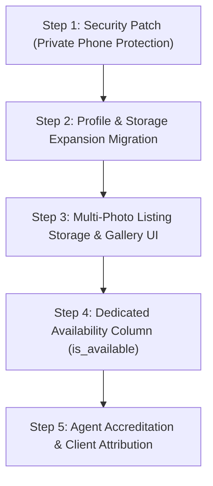

# LodgeMate Phase 3 — Comprehensive User Journey & System Audit

**Audit Timestamp:** 2026-11-20  
**Scope:** Complete Student, Landlord, and Independent Agent User Journeys, Supabase RLS & Backend Dependencies, Storage Policies, and Security Architecture.

---

## Executive Summary

This audit assesses the readiness of LodgeMate for Phase 3 before final backend integration. All critical user flows across Students, Landlords, and Independent Agents were inspected against the active codebase, database migrations (`supabase/migrations/*.sql`), and generated client types (`src/integrations/supabase/types.ts`).

### Overall System Health
- **TypeScript Typecheck (`npx tsc --noEmit`)**: **PASSED** (0 errors).
- **Vite Production SSR & Client Build (`npm run build`)**: **PASSED** (Vite v8.1.5 compiled in 3.43s).
- **Frontend Architecture**: High fidelity, resilient defensive fallbacks, zero synthetic mock leaks in production mode, and mobile-responsive layout.

---

## 1. Student Journey Audit

| Feature | Status | Notes & Evidence |
| :--- | :--- | :--- |
| **Registration & Login** | **WORKING** | Supports email/password & Google OAuth. Role persistence (`role = 'student'`), client-side validation, password confirmation, and error toasts in `src/routes/auth.tsx`. |
| **Password Recovery & Update** | **WORKING** | Forgot Password modal triggers Supabase `resetPasswordForEmail()`. Detection of `#type=recovery` and Supabase `PASSWORD_RECOVERY` event mounts password reset UI in `src/routes/auth.tsx`. |
| **Student Profile Creation & Editing** | **WORKING** | Name, phone, institution (`MOUAU` / `ABSU`), department, level, preferred accommodation type, budget min/max, and notes in `src/routes/_authenticated/profile.tsx`. |
| **Profile Picture Upload** | **IMPLEMENTED BUT UNTESTED** | Local preview works immediately. Remote storage upload to `avatars/{user_id}/*` is implemented in `profile.tsx` with defensive fallback if bucket is missing. |
| **Accommodation Browsing & Searching** | **WORKING** | Real-time multi-token keyword search across title, location, kind, amenities, and description in `src/routes/browse.tsx`. |
| **Campus, Type & Budget Filters** | **WORKING** | Campus (`All`, `MOUAU`, `ABSU`), Room Type (`Full lodge`, `Bedspace`, `Takeover`), Price presets and custom Min/Max inputs, and verified-only toggle in `src/routes/browse.tsx`. |
| **Landlord & Independent Agent Discovery** | **WORKING** | Dedicated "Landlords & Agents" scope on Browse. Searches names, agency names, and operating areas. Real-time listing-to-provider area resolution in `src/routes/browse.tsx`. |
| **Verified-Agent Filtering** | **WORKING** | Dedicated "Verified Agents" filter pill and dynamic "Verified agents only" toggle in `src/routes/browse.tsx`. |
| **Accommodation Details & Galleries** | **IMPLEMENTED BUT UNTESTED** | Dynamic route `src/routes/listings.$id.tsx` renders listing attributes and primary photo. Multi-photo gallery is limited to single photo by database schema. |
| **Saved Listings (Bookmarks)** | **WORKING** | Students can bookmark/unbookmark from listing cards, detail pages, and view saved rooms in `src/routes/_authenticated/dashboard.tsx` backed by `src/lib/saved-listings.ts`. |
| **Inspection Requests** | **WORKING** | Modal dialog on `listings.$id.tsx` and dashboard with required date picker and structured time slot selection (`morning`, `afternoon`, `evening`, `flexible`). |
| **Inspection Status Tracking** | **WORKING** | Status pills (`pending`, `confirmed`, `declined`) and filter tabs (`All`, `Confirmed`, `Pending`) in `src/routes/_authenticated/dashboard.tsx`. |
| **Confirmed Inspection Contact Details** | **WORKING** | Phone number and direct WhatsApp click-to-chat link unlock only when status is `confirmed`. Remains hidden while `pending`. |
| **Beta Lodges Access** | **WORKING** | Preview mode for all users; full phone number, video tour, and inspection notes unlock with active pass or provider ownership in `src/routes/beta-lodges.tsx`. |
| **Account Sign-Out** | **WORKING** | Accessible via `SiteHeader` dropdown and `profile.tsx` with alert confirmation dialog. Clears session and redirects safely. |

---

## 2. Landlord Journey Audit

| Feature | Status | Notes & Evidence |
| :--- | :--- | :--- |
| **Landlord Registration & Login** | **WORKING** | Host account selection with confirmation modal. Assigns `role = 'landlord'` and `provider_type = 'landlord'` in `src/routes/auth.tsx`. |
| **Role Assignment & Persistence** | **WORKING** | Handled by `handle_new_user()` trigger and `sync_user_signup_role()` RPC. Verified in `src/lib/auth-context.tsx`. |
| **Landlord Profile** | **WORKING** | Profile editor includes Property Business Name, Operating Area, School, and Caretaker Bio in `src/routes/_authenticated/profile.tsx`. |
| **Profile Picture Upload** | **IMPLEMENTED BUT UNTESTED** | File type (JPG, PNG, WebP) and size (5MB) validation with immediate preview and upload handler to `avatars` bucket. |
| **Listing Creation** | **WORKING** | Form in `src/routes/_authenticated/host.tsx` with title, school, area, distance, price, period, description, amenities, and photos. Sets `status = 'pending'`. |
| **Multiple Listing Photo Uploads** | **BLOCKED** | Frontend UI allows dragging/selecting up to 5 photos. Upload handler uploads primary photo to `listings` bucket. Storing multiple photo URLs is blocked by database schema (`listings.image_url text`). |
| **Listing Editing** | **WORKING** | Host can edit title, type, school, area, price, period, description, amenities, and photo in `src/routes/_authenticated/host.tsx`. Re-triggers `pending` moderation safeguard. |
| **Availability Management** | **WORKING** | Toggle button in `host.tsx` alternates status between `removed` (taken/off-market) and `pending` (available for re-approval). |
| **Listing Deletion** | **WORKING** | Hosts can permanently delete their own listings with browser confirmation in `host.tsx`. Enforced by RLS `listings_delete_own`. |
| **Inspection Notifications / Dashboard** | **WORKING** | Inspection requests list in `host.tsx` showing lodge title, requested date, time slot, and student note. |
| **Student Details for Inspections** | **WORKING** | Host view displays student's full name, phone number, click-to-call button, and pre-formatted WhatsApp chat link. |
| **Confirming & Declining Inspections** | **WORKING** | One-click action buttons in `host.tsx` execute updates to `inspections.status = 'confirmed' | 'declined'`. |
| **Sign-Out** | **WORKING** | Standard sign-out flow with full session destruction. |

---

## 3. Independent Agent Journey Audit

| Feature | Status | Notes & Evidence |
| :--- | :--- | :--- |
| **`provider_type = agent` Assignment** | **WORKING** | User selects "Independent Agent" during registration. Correctly saves `role = 'landlord'` and `provider_type = 'agent'` in `auth.users.raw_user_meta_data` and `public.profiles`. |
| **Agency Name & Operating Area** | **WORKING** | Displayed in `src/routes/_authenticated/profile.tsx` with custom labels ("Agency / Business Name" and "Primary Operating Area"). |
| **Independent-Agent Dashboard** | **WORKING** | `src/routes/_authenticated/host.tsx` adapts dynamically to show badge `"Independent Agent · Housing Representative"` and tailored instructions. |
| **Listing Ownership** | **WORKING** | Agents post spaces under their account. Listings have `owner_id = agent.id`. |
| **Inspection Management** | **WORKING** | Agents receive and manage inspection requests identically to landlords, accessing student contact details to coordinate physical lodge visits. |
| **Verification Status** | **WORKING** | Database verification column is checked. Displays `Verified` badge if `verified = true`, otherwise `Unverified`. |
| **Public Provider Discovery** | **WORKING** | Agents are surfaced on the Browse "Landlords & Agents" tab with business name, operating area, badge, and "View spaces" link. |
| **Property Owner / Client Differentiation** | **MISSING** | When an agent lists a lodge, there is no field to record the underlying property owner's name/contact. All listings are owned directly by the agent's account. |
| **Agent Accreditation Document Upload** | **MISSING** | No dedicated document upload pipeline for agent identity verification (e.g. CAC registration, student rep letter). Verification currently requires manual admin DB update. |

---

## 4. Security & Backend Dependencies Audit

### 4.1 Critical Security Vulnerability: `profiles_read_all`
- **Issue**: Migration `20260828125831_7fd6c391-f80c-4e9c-8dbc-193d69aabc50.sql` declares:
  ```sql
  CREATE POLICY "profiles_read_all" ON public.profiles FOR SELECT USING (true);
  ```
- **Risk**: PostgreSQL Row-Level Security checks row visibility, not column visibility. Consequently, unauthenticated visitors with the public Supabase `anon` key can query PostgREST directly:
  ```bash
  GET /rest/v1/profiles?select=id,full_name,phone
  ```
  This exposes the private phone numbers of all registered students, landlords, and agents.
- **Client Mitigation Already Active**: The client code never requests `phone` in public discovery queries.
- **Recommended Backend Fix**:
  1. Restrict `public.profiles` SELECT to row owner and admins:
     ```sql
     DROP POLICY IF EXISTS "profiles_read_all" ON public.profiles;
     CREATE POLICY "profiles_read_own" ON public.profiles
       FOR SELECT TO authenticated
       USING (auth.uid() = id OR public.has_role(auth.uid(), 'admin'));
     ```
  2. Deploy a secure RPC or View that strictly projects public fields:
     ```sql
     CREATE OR REPLACE FUNCTION public.get_public_providers()
     RETURNS TABLE (
       id uuid,
       full_name text,
       provider_type text,
       school text,
       avatar_url text,
       business_name text,
       operating_area text,
       bio text,
       verified boolean,
       created_at timestamptz
     )
     LANGUAGE sql STABLE SECURITY DEFINER SET search_path = public AS $$
       SELECT id, full_name, provider_type, school, avatar_url, business_name, operating_area, bio, verified, created_at
       FROM public.profiles
       WHERE banned = false AND provider_type IN ('landlord', 'agent');
     $$;
     GRANT EXECUTE ON FUNCTION public.get_public_providers() TO anon, authenticated;
     ```

### 4.2 Storage Bucket Dependencies
- **`listing-images` / `listings` bucket**: Needs to be provisioned as a public read bucket with authenticated owner upload policy (`listings/{user_id}/*`).
- **`avatars` bucket**: Drafted locally in `20261114000000_avatars_and_profiles_expansion.sql` (public read, authenticated user folder upload). Needs deployment to remote Supabase Storage.

### 4.3 Missing Columns & Foreign Keys
1. **`listings.image_urls text[]` or `listing_images` table**:
   - Currently, `listings` only has a single `image_url text` column. Storing multiple photographs per listing is blocked until this column or relation table is added.
2. **`listings.is_available boolean`**:
   - The remote schema lacks an availability flag. Currently, availability is toggled using `status = 'removed'`, which hides listings from Browse but requires campus rep re-approval (`status = 'pending'`) to restore. A dedicated `is_available boolean NOT NULL DEFAULT true` column will allow instant re-activation without re-triggering moderation.
3. **`profiles.business_name`, `operating_area`, `bio`, `verified`, `avatar_url`**:
   - Defined in local migration `20261114000000_avatars_and_profiles_expansion.sql`. Must be deployed to remote database to persist host business profiles permanently.

---

## 5. Summary of Missing Functionality

1. **Multiple Photo Carousel on Listing Details**:
   - `src/routes/listings.$id.tsx` only renders `listing.image` because only one URL is saved. A thumbnail strip/carousel should be implemented once `image_urls text[]` is available.
2. **Dedicated `is_available` Column**:
   - Needed so hosts can take a room off the market without resetting verification or requiring re-approval when it becomes available again.
3. **Agent Client / Landlord Attestation**:
   - Independent agents cannot currently record the owner's name or landlord contact on listings they manage.
4. **Direct Inspection Rescheduling**:
   - Inspections can only be "Confirmed" or "Declined". A "Propose alternative time" feature would streamline scheduling.

---

## 6. Recommended Implementation Order for Phase 4



1. **Step 1 — Security Hardening (Highest Priority)**:
   - Deploy `profiles_read_own` RLS policy.
   - Deploy `get_public_providers()` RPC to secure private phone numbers against direct PostgREST scraping.
2. **Step 2 — Deploy Profiles & Storage Expansion**:
   - Apply `20261114000000_avatars_and_profiles_expansion.sql` to add `business_name`, `operating_area`, `bio`, `verified`, `avatar_url`, and the `avatars` bucket.
3. **Step 3 — Multi-Photo Listings Schema & UI**:
   - Add `image_urls text[] DEFAULT '{}'` to `public.listings`.
   - Update `uploadListingPhotos()` to upload all selected files.
   - Add photo carousel/gallery to `src/routes/listings.$id.tsx`.
4. **Step 4 — Dedicated Availability Flag**:
   - Add `is_available boolean NOT NULL DEFAULT true` to `public.listings`.
   - Update public Browse query to filter `is_available = true`.
   - Update host toggle to flip `is_available` without changing moderation status.
5. **Step 5 — Independent Agent Enhancements**:
   - Add optional `client_landlord_name` field on listing creation for agents.

---

## 7. Files That Need Modification in Phase 4

| File | Purpose of Modification |
| :--- | :--- |
| `supabase/migrations/20261120000000_security_and_listings_expansion.sql` | New migration: RLS hardening for `profiles`, `get_public_providers()` RPC, `image_urls text[]`, and `is_available boolean`. |
| `src/lib/providers.ts` | Switch provider query to use `supabase.rpc('get_public_providers')` with fallback. |
| `src/components/listing-image-upload.tsx` | Upload all selected photos and return array of URLs. |
| `src/routes/_authenticated/host.tsx` | Save `image_urls` array on create/edit; toggle `is_available` column. |
| `src/routes/listings.$id.tsx` | Add multi-image gallery/carousel slider for accommodations with multiple photos. |
| `src/routes/browse.tsx` | Add `is_available = true` condition to Browse query. |

---

## 8. TypeScript & Build Results

- **`npx tsc --noEmit`**:
  - Exit Code: **0**
  - Errors: **0**
- **`npm run build`**:
  - Exit Code: **0**
  - Client bundle generated in: `.output/public`
  - SSR bundle generated in: `.output/server`
  - Build Duration: **3.43s**
